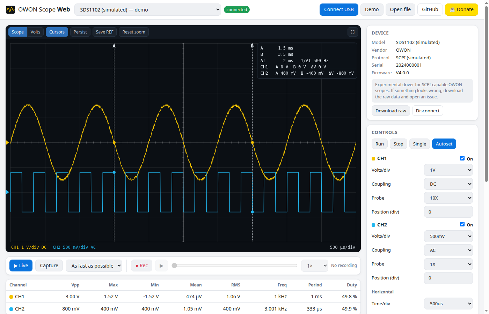
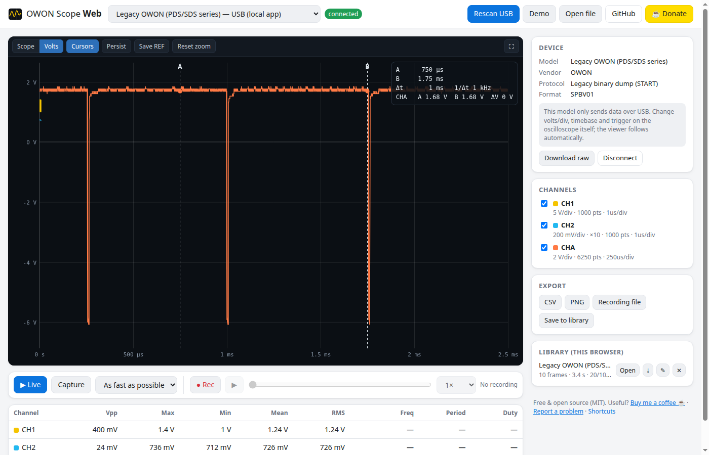

# OWON Scope Web

**Use your OWON oscilloscope from the browser over USB** — live view, automatic measurements, cursors,
recording and playback. No Windows-only software needed: it works on Linux, macOS and Windows.

[](https://github.com/fmesasc/owon-scope-web/actions/workflows/ci.yml)
[](https://fmesasc.github.io/owon-scope-web/)
[](LICENSE)
[](https://paypal.me/fmesasc)

### ▶ [Open the web app](https://fmesasc.github.io/owon-scope-web/) · [Try the demo (no hardware)](https://fmesasc.github.io/owon-scope-web/?demo)



It detects the scope, works out **which protocol it speaks** (old PDS-style binary dump or modern SCPI)
and shows the options that make sense for that model.

## Features

- **Automatic detection** of OWON scopes on USB and of their protocol.
- **Live view** like the instrument's screen (each channel at its own V/div), or a **volts/seconds view** with all channels on real axes.
- **Measurements**: Vpp, max, min, mean, RMS, frequency, period, duty cycle.
- **Cursors** with Δt, 1/Δt and the voltage of each channel at both cursors.
- **Zoom & pan** (mouse wheel, drag), **persistence**, **reference traces** (freeze and compare).
- **Recording**: record every frame, scrub the timeline, play it back at 0.25×–20×.
  Slow capture intervals (up to one frame per minute) for long-term logging.
- **Library**: keep recordings in your browser; download them as `.owonrec` files and open them again later (or share them).
- **Export**: CSV, PNG, recording files and the device's raw data. CSV files exported by the app can be opened again.
- **Remote control** of modern (SCPI) scopes: run/stop/single/autoset, V/div, coupling, probe, position, timebase, trigger.
- Command line: `--list`, `--capture file.csv`.
- Works offline. Nothing is uploaded anywhere: your data stays in your browser.

## Supported oscilloscopes

| Family | Protocol | Status |
|---|---|---|
| **PDS5022S** | legacy binary dump (`START`) | ✅ tested |
| PDS6042S, PDS6062S/T, PDS7102T, early SDS/MSO with old firmware (also rebranded Lilliput units) | legacy binary dump | should work: same protocol |
| SDS (current firmware), XDS, TAO, HDS, DOS… | SCPI over USB (raw bulk or USBTMC) | 🧪 implemented from OWON's programming manual, **not yet tested on hardware** |
| VDS1022 / VDS2062 (PC-only scopes) | own protocol with FPGA firmware upload | ❌ not supported yet |

All OWON devices share the USB ID `5345:1234` (that's why `lsusb` may call your PDS5022S a "PDS6062T"),
so the app identifies them by how they answer, not by their ID.

**Have a different model?** Connect it, press **Download raw** and
[open an issue](https://github.com/fmesasc/owon-scope-web/issues) with the model name and that file.
That is usually all that's needed to add it.

## Two ways to use it

### 1. In the browser, nothing to install (Chrome / Edge)

Open **https://fmesasc.github.io/owon-scope-web/**, click **Connect USB** and pick your scope.
This uses [WebUSB](https://developer.mozilla.org/docs/Web/API/WebUSB_API), which Chrome, Edge and other
Chromium browsers support (Firefox and Safari don't).

- **Linux:** install the [udev rule](#linux-usb-permissions) once.
- **Windows:** the browser needs the generic WinUSB driver for the scope. Install it with
  [Zadig](https://zadig.akeo.ie/) (Options → List all devices → pick the OWON device → WinUSB → Replace driver).
  This replaces OWON's own driver; you can roll back from Device Manager.
- **macOS:** usually works directly.

### 2. Local app (any browser, also from other devices on your network)

A small Python program talks to the scope and serves the same web interface at `http://localhost:8642`.

<a id="install"></a>

```bash
pipx install git+https://github.com/fmesasc/owon-scope-web
owon-scope-web            # opens your browser
```

Or with plain pip: `pip install git+https://github.com/fmesasc/owon-scope-web`.
It needs Python 3.9+ and libusb (`sudo apt install libusb-1.0-0` on Debian/Ubuntu; `brew install libusb` on macOS).

```text
owon-scope-web --list                 # detect connected scopes and exit
owon-scope-web --capture scope.csv    # capture once to CSV and exit
owon-scope-web --host 0.0.0.0         # let phones/tablets on your network use it
owon-scope-web --demo                 # add two simulated scopes
owon-scope-web --usb 1234:5678        # also probe a rebranded scope with another USB ID
```

<a id="linux-usb-permissions"></a>

### Linux USB permissions

By default only root can open USB devices. Install the rule (needed for both ways of using the app),
then unplug and plug the scope back in:

```bash
curl -fsSLO https://fmesasc.github.io/owon-scope-web/99-owon.rules
sudo cp 99-owon.rules /etc/udev/rules.d/
sudo udevadm control --reload && sudo udevadm trigger
```

The rule ([udev/99-owon.rules](udev/99-owon.rules)) also detaches the `usb_serial_simple` driver that Linux
attaches to older OWON scopes, so the browser can use them.



## Recording file format

`.owonrec` files are gzip-compressed JSON:

```json
{
  "format": "owon-scope-web/recording", "version": 1,
  "name": "…", "created": 1760000000000, "device": { "model": "…" },
  "frames": [ { "timestamp": 1760000000.1, "time_per_div": 0.0005, "settings": {},
                "waveforms": [ { "name": "CH1", "dt": 3.3e-6, "volts_per_div": 1, "position_div": 0,
                                 "volts": "<base64 little-endian float32>" } ] } ]
}
```

## How it works

```
 OWON scope ──USB──┬── Chrome/Edge (WebUSB) ─────────────┐
                   └── owon-scope-web (Python, pyusb) ───┴──► same web UI
```

**Legacy protocol** (reverse engineered on a PDS5022S): the host writes `START` to the bulk OUT endpoint;
the scope answers with a 12-byte header (little-endian payload length) and a dump starting with `SPBV01`.
Each channel block is: name (3 bytes), block length, seven int32 (samples, screen samples, slow-move,
timebase index, vertical offset, V/div index, probe index), four float32 (µs per sample, frequency,
period, mV per count) and the int16 samples. One division is 25 counts. The firmware answers any number of
requests per session (about 10 captures per second), but stops answering if the host sends `SET_CONFIGURATION`
or `CLEAR_HALT` when opening the device, so the app never does. See [owonscope/legacy.py](owonscope/legacy.py).

**SCPI protocol**: `*IDN?`, `:DATA:WAVE:SCREen:HEAD?` (JSON description of the screen) and
`:DATA:WAVE:SCREen:CH<n>?` (samples), plus the usual `:CHANnel`, `:HORizontal`, `:TRIGger` commands.
See [owonscope/scpi.py](owonscope/scpi.py).

Detection tries SCPI first (legacy scopes simply don't answer it) and then the legacy dump.

## Development

```bash
git clone https://github.com/fmesasc/owon-scope-web && cd owon-scope-web
pip install -e ".[test]"
pytest                      # Python tests (use a real PDS5022S dump and simulated devices)
node --test tests/js/       # JavaScript protocol tests
python -m owonscope --demo  # run locally with simulated scopes
```

The web UI is plain HTML/CSS/JavaScript modules in [owonscope/web](owonscope/web), with no build step and no
external dependencies. Every push to `main` runs the tests and, only if they pass, publishes the web app to
GitHub Pages.

Contributions are welcome, especially tests with other OWON models.

## Support

If this project is useful to you and you'd like to see more like it, consider buying me a coffee :) — it helps
me keep developing and improving it. Thank you!

[](https://paypal.me/fmesasc)

## License

[MIT](LICENSE) © Francisco Mesas Cervilla.

OWON is a trademark of its owner. This is an independent project, not affiliated with or endorsed by OWON or Lilliput.
